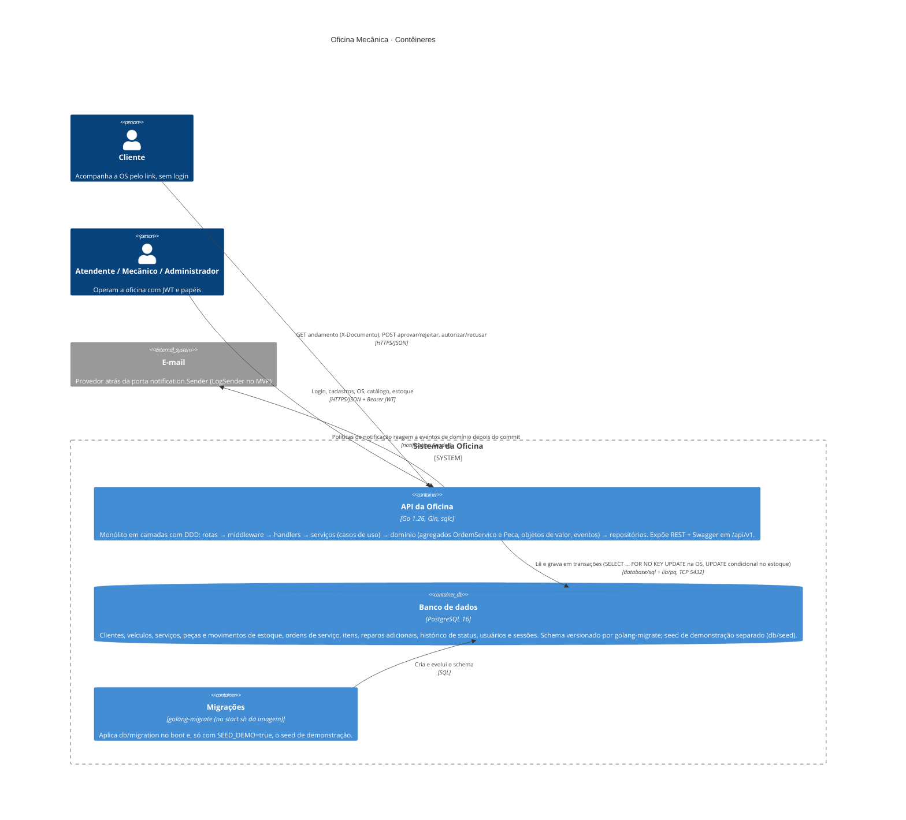

# C4 · Nível 2 · Contêineres

O que roda dentro do sistema da oficina. Um contêiner no C4 é uma unidade executável ou de dados, não necessariamente um contêiner Docker (aqui, por coincidência, cada um é um serviço do `docker-compose.yaml`).

## Dentro da API (camadas)

| Camada | Pacotes | Responsabilidade |
|---|---|---|
| HTTP | `internal/routes`, `internal/middleware`, `internal/handler`, `internal/dto` | Rotas e papéis por rota, autenticação JWT, limite de tentativas, limite de corpo, log de acesso sem dado pessoal, binding e mapeamento erro → status, Swagger |
| Aplicação | `internal/service` | Um método por comando: abre a unidade de trabalho, carrega o agregado pelo repositório, chama a raiz, salva, publica os eventos; consultas pelo read model; políticas como handlers de eventos |
| Domínio | `internal/domain/...` | Agregados `OrdemServico` (itens, reparos, máquina de estados, orçamento) e `Peca` (saldo, movimentos), objetos de valor (`Documento`, `Placa`, `Status`), eventos de domínio e as portas de repositório |
| Infraestrutura | `internal/repository`, `internal/readmodel`, `internal/eventos`, `db/sqlc`, `db/migration`, `notification`, `token` | Implementação das portas com sqlc, projeções de leitura, despachante de eventos, acesso ao PostgreSQL e transações, e-mail (log), JWT |

## Decisões relacionadas

- [ADR 0001 · PostgreSQL](../adr/0001-postgresql.md)
- [ADR 0002 · JWT como autenticação](../adr/0002-jwt-com-opcao-paseto.md)
- [ADR 0003 · Estoque sem reserva](../adr/0003-estoque-sem-reserva.md)
- [ADR 0004 · Rejeição volta para diagnóstico](../adr/0004-rejeicao-volta-para-diagnostico.md)
- [ADR 0005 · Acompanhamento sem login](../adr/0005-acompanhamento-sem-login.md)
- [ADR 0006 · Eventos de domínio em processo](../adr/0006-eventos-de-dominio-em-processo.md)

Nível anterior: [contexto](c4-contexto.md). Requisitos não funcionais: [requisitos-nao-funcionais.md](requisitos-nao-funcionais.md). Débito técnico: [debito-tecnico.md](debito-tecnico.md).
