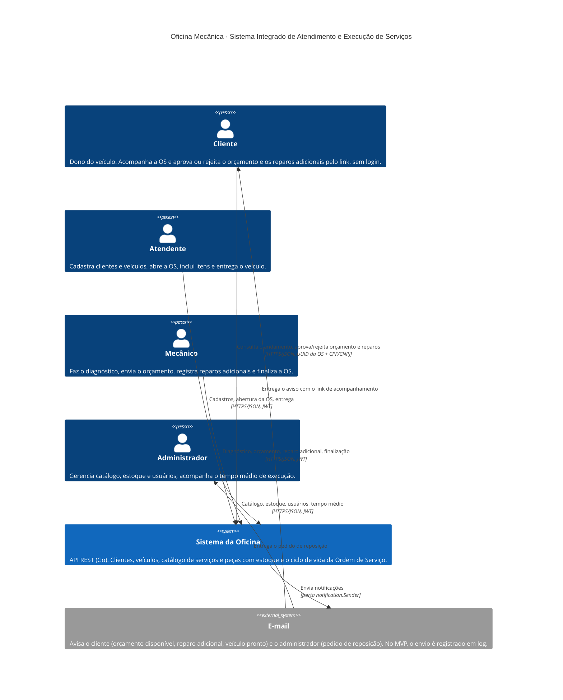

# C4 · Nível 1 · Contexto do sistema

Quem usa o Sistema Integrado de Atendimento e Execução de Serviços da oficina e com o que ele conversa. Notação do [C4 Model](https://c4model.com/) em Mermaid (`C4Context`).

## Leitura

- **Quatro pessoas, um sistema.** O cliente não tem conta: o link de acompanhamento com o UUID da OS mais o CPF/CNPJ do dono faz o papel de credencial (ADR 0005). Atendente, mecânico e administrador entram com JWT (ADR 0002) e têm papéis distintos (`RequireRole`).
- **Um sistema externo.** O e-mail é a única integração para fora. O sistema só conhece a porta `notification.Sender`; o provedor fica atrás dela (no MVP, `LogSender`). As notificações saem como reação a eventos de domínio publicados depois do commit (ADR 0006).
- **Fora do escopo do MVP:** pagamento, agenda, emissão fiscal e integração com fornecedores de peças. O "pedido de reposição" é um aviso ao administrador, não uma compra.

Próximo nível: [contêineres](c4-conteineres.md).
