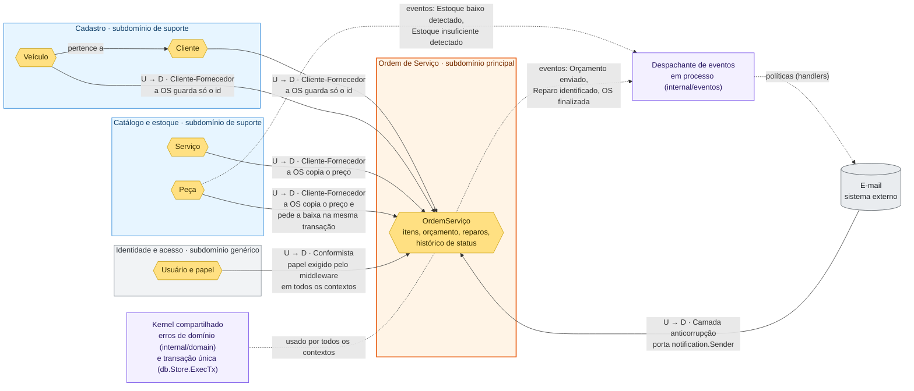

# Mapa de contexto

Mostra os bounded contexts do sistema, o tipo de subdomínio de cada um e como eles se integram. Os termos seguem a [linguagem ubíqua](linguagem-ubiqua.md) (§3.1). O fluxo de negócio está no [Event Storming](event-storming.pdf) e nas histórias de [Domain Storytelling](domain-storytelling/).

O sistema é um monólito com um só banco. Os contextos são separados por pacote e por tabela, não por serviço. A integração entre a OS e os demais contextos acontece de duas formas: leituras e a baixa de estoque passam por portas (`service.Catalogo`, `estoque.Repositorio`) dentro da mesma transação; as reações (notificar o cliente, pedir reposição) acontecem por **eventos de domínio em processo**, publicados depois do commit por um despachante síncrono (`internal/eventos`).

## Subdomínios

| Contexto | Tipo | Por quê |
|---|---|---|
| **Ordem de Serviço** | Principal | É o negócio da oficina: ciclo de vida da OS, orçamento, aprovação, reparo adicional, acompanhamento pelo cliente e tempo de execução. |
| **Cadastro** | Suporte | A OS precisa do cliente e do veículo, mas o cadastro não tem regra que diferencie a oficina. Regras: CPF ou CNPJ válido e único, placa válida, veículo com dono. |
| **Catálogo e estoque** | Suporte | Fornece serviços, peças, insumos, preços e saldo. Regras próprias: estoque mínimo, reposição, ajuste e movimentos. |
| **Identidade e acesso** | Genérico | Login, sessão e papéis (atendente, mecânico, administrador). É um problema comum a qualquer sistema. |

## Relações entre os contextos

U = upstream (fornece). D = downstream (consome).

| Relação | Padrão | Como funciona | Onde está no código |
|---|---|---|---|
| Cadastro → Ordem de Serviço | Cliente-Fornecedor | A OS busca o cliente pelo documento e o veículo pela placa pela porta `service.Catalogo`. Guarda só os ids. | `AbrirOrdemServico` em `internal/service/ordem_servico_comandos.go`; `internal/repository/catalogo_sqlc.go` |
| Catálogo e estoque → Ordem de Serviço | Cliente-Fornecedor | Ao incluir um item, a OS copia o preço do serviço ou da peça para o item (`ValorUnitarioCentavos`). Se o preço mudar depois, o orçamento não muda. Ao iniciar a execução, a OS pede a baixa das peças na mesma transação, pelo agregado `Peca` (`Baixar`) e pelo repositório de estoque (UPDATE condicional). | Portas `service.Catalogo` (serviço) e `estoque.Repositorio` (peça), implementadas em `internal/repository`; `OrdemServico.AdicionarServico/AdicionarPeca` em `internal/domain/ordemservico`; `baixarEstoque` em `internal/service/ordem_servico_service.go` |
| Identidade e acesso → todos | Conformista | Os contextos usam o papel do usuário como o middleware entrega, sem tradução. | `internal/middleware/auth.go` (`RequireRole`), `token/` |
| E-mail → Ordem de Serviço | Camada anticorrupção | A OS não chama o e-mail: ela publica eventos (Orçamento enviado ao cliente, Reparo adicional identificado, OS finalizada) e as políticas de notificação reagem pela porta `notification.Sender`. O provedor fica atrás dela. No MVP, o envio é só registrado em log (`LogSender`). | `internal/service/politicas.go`, `notification/sender.go`, `cmd/server/main.go` |
| Catálogo e estoque → E-mail | Eventos de domínio em processo | O agregado `Peca` registra Estoque baixo detectado e Estoque insuficiente detectado; a política de reposição avisa o administrador. O serviço da OS publica os eventos depois do commit (e o de estoque insuficiente mesmo com a transação desfeita). | `internal/domain/estoque/eventos.go`, `internal/eventos/despachante.go`, `internal/service/politicas.go` |
| Todos os contextos | Kernel compartilhado | Os contextos usam os mesmos erros de domínio e a mesma transação de banco. | `internal/domain/errors.go`, `db/sqlc/store.go` |

## Limites conhecidos

- **As portas entre os contextos existem, mas o modelo é o mesmo.** A OS não toca mais as tabelas de Cadastro e de Estoque: lê cliente, veículo e serviço pela porta `service.Catalogo` e muda saldo pelo agregado `estoque.Peca` e pela porta `estoque.Repositorio`. Ainda não há camada anticorrupção de verdade: as portas devolvem o modelo do outro contexto como ele é (sem tradução), porque os dois moram no mesmo monólito e no mesmo banco. Para separar os contextos em serviços, cada porta ganha um adaptador (HTTP, fila) e um tradutor.
- **A baixa de estoque é síncrona e na mesma transação.** O Event Storming mostra o evento *Execução iniciada* disparando a baixa. No código, a raiz registra o evento, mas a baixa acontece na mesma transação (pelo agregado `Peca` e pelo UPDATE condicional), e não como reação ao evento: a consistência forte entre OS e estoque é o ponto crítico do domínio. Os eventos só disparam reações depois do commit.
- **O despachante é síncrono e em processo.** Os handlers rodam na mesma requisição, depois do commit; não há fila nem persistência de eventos. Se o processo cair entre o commit e a publicação, a notificação se perde (o estado da OS não). Uma fila (outbox) é a evolução natural quando os contextos virarem serviços.
- **Quem confere o estoque mínimo é o agregado `Peca`** (`Estoque baixo detectado`), e a política de reposição mora na aplicação (`internal/service/politicas.go`), não no contexto de estoque.
