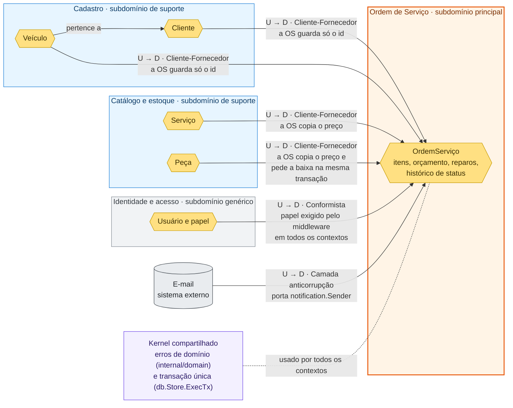

# Mapa de contexto

Mostra os bounded contexts do sistema, o tipo de subdomínio de cada um e como eles se integram. Os termos seguem a [linguagem ubíqua](linguagem-ubiqua.md) (§3.1). O fluxo de negócio está no [Event Storming](event-storming.pdf) e nas histórias de [Domain Storytelling](domain-storytelling/).

O sistema é um monólito com um só banco. Os contextos são separados por pacote e por tabela, não por serviço. Por isso, a integração acontece por chamada direta no código, dentro da mesma transação.

## Subdomínios

| Contexto | Tipo | Por quê |
|---|---|---|
| **Ordem de Serviço** | Principal | É o negócio da oficina: ciclo de vida da OS, orçamento, aprovação, reparo adicional, acompanhamento pelo cliente e tempo de execução. |
| **Cadastro** | Suporte | A OS precisa do cliente e do veículo, mas o cadastro não tem regra que diferencie a oficina. Regras: CPF ou CNPJ válido e único, placa válida, veículo com dono. |
| **Catálogo e estoque** | Suporte | Fornece serviços, peças, insumos, preços e saldo. Regras próprias: estoque mínimo, reposição, ajuste e movimentos. |
| **Identidade e acesso** | Genérico | Login, sessão e papéis (atendente, mecânico, administrador). É um problema comum a qualquer sistema. |

## Relações entre os contextos

U = upstream (fornece). D = downstream (consome).

| Relação | Padrão | Como funciona | Onde está no código |
|---|---|---|---|
| Cadastro → Ordem de Serviço | Cliente-Fornecedor | A OS busca o cliente pelo documento e o veículo pela placa. Guarda só os ids. | `AbrirOrdemServico` em `internal/service/ordem_servico_service.go` |
| Catálogo e estoque → Ordem de Serviço | Cliente-Fornecedor | Ao incluir um item, a OS copia o preço do serviço ou da peça para o item (`ValorUnitarioCentavos`). Se o preço mudar depois, o orçamento não muda. Ao iniciar a execução, a OS pede a baixa das peças na mesma transação. | `incluirServico`, `incluirPeca` e `baixarEstoque` em `ordem_servico_service.go`; regras em `internal/domain/estoque` |
| Identidade e acesso → todos | Conformista | Os contextos usam o papel do usuário como o middleware entrega, sem tradução. | `internal/middleware/auth.go` (`RequireRole`), `token/` |
| E-mail → Ordem de Serviço | Camada anticorrupção | A OS só conhece a porta `notification.Sender`. O provedor fica atrás dela. No MVP, o envio é só registrado em log (`LogSender`). | `notification/sender.go`, `cmd/server/main.go` |
| Todos os contextos | Kernel compartilhado | Os contextos usam os mesmos erros de domínio e a mesma transação de banco. | `internal/domain/errors.go`, `db/sqlc/store.go` |

## Limites conhecidos

- **Não há camada anticorrupção entre os contextos internos.** O serviço da OS consulta as tabelas de Cadastro e de Catálogo e estoque direto pelo `db.Querier`. Para separar os contextos em serviços, a OS precisaria de portas próprias (ex.: consulta de cliente, gestão de estoque).
- **A baixa de estoque é síncrona e na mesma transação.** O Event Storming mostra o evento *Execução iniciada* disparando a baixa. No código, isso é uma chamada direta, sem evento publicado.
- **A notificação do estoque baixo sai da OS.** Quem confere o estoque mínimo depois da baixa é o serviço da OS (`notificarEstoqueBaixo`), não o contexto de estoque.
