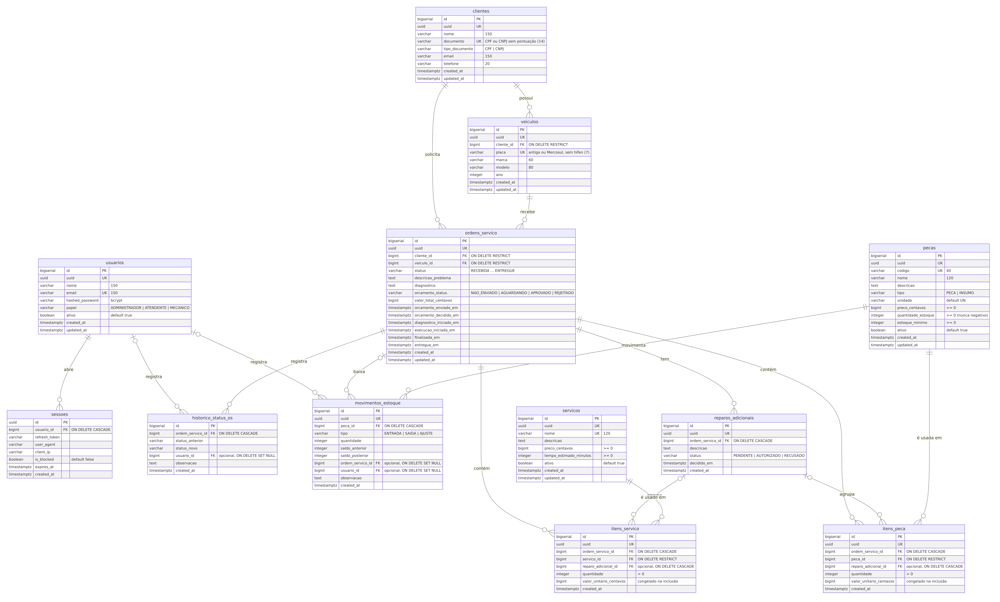
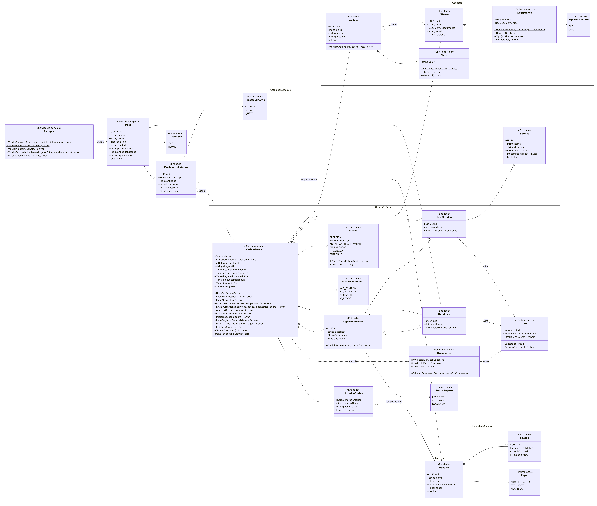

# Modelagem: DER e diagrama de classes

Dois diagramas que descrevem o mesmo modelo por ângulos diferentes:

- **DER (Diagrama Entidade-Relacionamento):** as tabelas do PostgreSQL, como estão nas migrations de `db/migration/`.
- **Diagrama de classes (UML):** o modelo de domínio, agrupado pelos contextos delimitados do [mapa de contexto](../ddd/mapa-de-contexto.md).

Os fontes estão em Mermaid (`.mmd`). As imagens `.svg` e `.png` são geradas a partir deles (veja [Como gerar de novo](#como-gerar-de-novo)).

## DER



Fonte: [der.mmd](der.mmd) · Vetor: [der.svg](der.svg)

**Leitura:**

- 12 tabelas. Todas as entidades têm `id` (`bigserial`, chave interna das FKs) e `uuid` (identificador exposto na API). As exceções são `sessoes`, cuja chave já é um UUID, e `historico_status_os`, que só tem `id`.
- **Restrições que protegem o negócio:**
  - `CHECK (quantidade_estoque >= 0)`: o saldo da peça nunca fica negativo;
  - `CHECK` nos status da OS, do orçamento e do reparo;
  - `UNIQUE` em documento do cliente, placa, código da peça, nome do serviço e e-mail do usuário.
- **Exclusão:**
  - `RESTRICT` impede apagar um cliente com veículo ou OS, um veículo com OS, e um serviço ou peça que já está numa OS;
  - `CASCADE` apaga junto o que pertence à OS (itens, reparos, histórico) e as sessões do usuário;
  - `SET NULL` mantém movimentos e histórico quando o usuário ou a OS somem.
- **Reparo adicional:** os itens de um reparo ficam em `itens_servico` e `itens_peca`, com `reparo_adicional_id` preenchido. Itens do orçamento original têm esse campo nulo.
- **Valor congelado:** `valor_unitario_centavos` guarda o preço do item no momento em que ele entrou na OS. Mudar o preço no catálogo não altera OS já abertas.

## Diagrama de classes (UML)



Fonte: [diagrama-de-classes.mmd](diagrama-de-classes.mmd) · Vetor: [diagrama-de-classes.svg](diagrama-de-classes.svg)

**Leitura:**

- **Estereótipos:** «Raiz de agregado», «Entidade», «Objeto de valor», «Serviço de domínio» e «enumeração», com os nomes da [linguagem ubíqua](../ddd/linguagem-ubiqua.md).
- **Relações:**
  - composição (◆): a parte só existe dentro do todo, como os itens, reparos e histórico dentro da OS;
  - agregação (◇): o reparo agrupa itens da OS;
  - associação (→): referência entre agregados pelo identificador;
  - dependência (⇢): uso, como a OS que calcula o `Orcamento` a partir dos `Item`.
- **`OrdemServico`** é a raiz do agregado principal. Os métodos são os comandos do domínio, e cada um valida a transição de status (`Status.PodeIrPara`) antes de mudar o estado.
- **`Peca`** é a raiz do agregado de estoque. As regras de saldo ficam no serviço de domínio `Estoque`.
- `$` marca métodos e funções de pacote, que no diagrama aparecem como estáticos (por exemplo, `NovoDocumento` e `CalcularOrcamento`).

### Onde cada classe está no código

| Classe | Código |
|---|---|
| `OrdemServico`, `Status`, `StatusOrcamento`, `StatusReparo` | `internal/domain/ordemservico/ordem_servico.go`, `status.go` |
| `Item`, `Orcamento` | `internal/domain/ordemservico/orcamento.go` |
| `ReparoAdicional` (`DecidirReparo`) | `internal/domain/ordemservico/ordem_servico.go`; dados em `db.ReparoAdicional` |
| `Documento`, `TipoDocumento` | `internal/domain/cliente/documento.go` |
| `Placa` (`ValidarAno`) | `internal/domain/veiculo/placa.go` |
| `Estoque`, `TipoPeca`, `TipoMovimento` | `internal/domain/estoque/estoque.go` |
| `Cliente`, `Veiculo`, `Servico`, `Peca`, `MovimentoEstoque`, `ItemServico`, `ItemPeca`, `HistoricoStatus`, `Usuario`, `Sessao` | structs geradas pelo sqlc em `db/sqlc/models.go` (`db.Cliente`, `db.Veiculo`, …). Os casos de uso em `internal/service` aplicam as regras do domínio sobre elas. |
| `Papel` | `internal/middleware/auth.go` (`PapelAdministrador`, `PapelAtendente`, `PapelMecanico`) e `CHECK` da tabela `usuarios` |

## Como gerar de novo

Depois de mudar um `.mmd`, rode na pasta `docs/modelagem`:

```bash
for f in der diagrama-de-classes; do
  docker run --rm -u $(id -u):$(id -g) -v "$PWD":/data minlag/mermaid-cli:11.4.2 -i /data/$f.mmd -o /data/$f.svg -b white
  docker run --rm -u $(id -u):$(id -g) -v "$PWD":/data minlag/mermaid-cli:11.4.2 -i /data/$f.mmd -o /data/$f.png -b white -w 2400 -s 2
done
```
